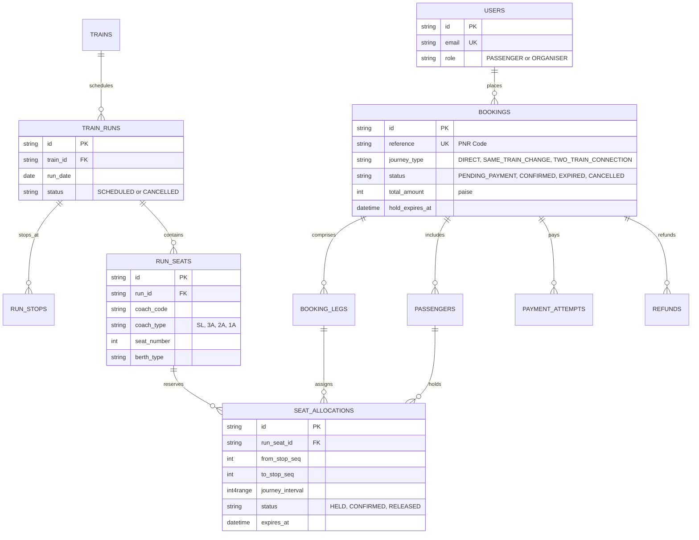

# RailNova 🚆
> **“Your journey, thoughtfully connected.”**

A complete, production-grade demonstration of a high-concurrency railway reservation platform built with PostgreSQL-backed segment-based inventory, atomic multi-leg holds, dynamic pricing, and an interactive organiser console.

Recently enhanced with **5 Intelligent Railway Extensions**:
1. 🚀 **Journey Autopilot**: Time-expanded graph search with multi-objective Pareto ranking.
2. 🛡️ **Connection Risk Engine**: Transparent transfer risk scoring ($0-100$) evaluating connection feasibility.
3. 🧪 **What-If Journey Simulator**: Isolated operational disruption sandbox for delay injection, cancellation simulation, and recovery discovery.
4. ⚡ **Booking Race Replay**: Real-time visual demonstration of PostgreSQL concurrency protection against simultaneous competing claims.
5. 💬 **Explainable Travel Assistant**: Deterministic NLP parser converting conversational goals into structured search constraints with complete reasoning traces.

---

## 🌟 Key Highlights & Core Systems

### 1. Segment-Based Inventory & Station Intervals
- Train stops are modeled as an ordered sequence ($S_0 \rightarrow S_1 \rightarrow S_2 \dots$).
- A journey from $S_{from}$ to $S_{to}$ occupies the half-open interval $[S_{from}, S_{to})$.
- Concurrency-safe interval overlap formula:
  $$\text{existing.from} < \text{requested.to} \quad \text{AND} \quad \text{requested.from} < \text{existing.to}$$
- **Non-Overlapping Seat Reuse**: Passenger A can book Delhi ➔ Kanpur and Passenger B can book Kanpur ➔ Howrah on the **exact same seat** with zero conflict.

### 2. High-Concurrency Race Condition Immunity (The "Tatkal" Rush)
- Evaluated under 20 simultaneous millisecond requests competing for the exact same berth.
- Enforces a deterministic lock hierarchy and serialized row-locking transactions (`SELECT ... FOR UPDATE`).
- Backed by integer ranges (`int4range`) and GiST exclusion constraint predicates.
- **Zero double-booking guarantee**.

### 3. Realistic Coach Layouts & Berth Types
- Modeled after authentic Indian Railway coach types:
  - **Sleeper (SL)**: 72 berths across 9 bays (Lower, Middle, Upper, Side Lower, Side Upper).
  - **3 Tier AC (3A)**: 64 berths across 8 bays.
  - **2 Tier AC (2A)**: 48 berths across 8 bays.
  - **1st AC (1A)**: 18 luxury berths/coupes.

### 4. Journey Autopilot (Intelligent Multi-Train Planner)
- Time-expanded directed graph search evaluating direct, seat-change, and multi-train itineraries.
- Multi-objective composite scoring formula balancing 4 key passenger priorities:
  $$\text{Score} = 100 - (w_f \cdot \hat{F} + w_d \cdot \hat{D} + w_t \cdot \hat{T} + w_r \cdot \hat{R})$$
- Configurable objective profiles: `BALANCED`, `CHEAPEST`, `FASTEST`, `SAFEST`.
- Hard constraints filtering: arrival deadline, maximum transfers, minimum connection buffer, passenger count, and preferred berth.
- Seamless 1-click booking integration into active PostgreSQL reservations.

### 5. Connection Risk Engine
- Deterministic, transparent risk score ($0-100$) for connecting itineraries:
  - **Buffer Safety**: Evaluates scheduled transfer buffer against minimum connection threshold.
  - **Delay Ingestion**: Real-time delay propagation from operational and simulated feeds.
  - **Transfer Station Complexity**: Incorporates station dwell requirements and foot-traffic factors.
  - **Risk Tiers**: `SAFE` ($<25$), `MODERATE` ($25-60$), `HIGH` ($>60$), `IMPOSSIBLE` ($100$).
- Human-readable explanations for every deduction.

### 6. What-If Journey Simulator
- Dedicated administrator sandbox for testing network stress and timetable disruptions:
  - **Delay Injection**: Delay any train run by $N$ minutes.
  - **Emergency Run Cancellation**: Flag a train as cancelled and observe broken transfers.
  - **Seat Capacity Blocks**: Simulate maintenance outages or coach de-linking.
  - **Surge Multiplier**: Dynamically test demand-based pricing shocks.
  - **1-Click Reset**: Restores original baseline schedule instantly.
- Keeps simulation changes strictly isolated from actual confirmed bookings.

### 7. Booking Race Replay
- Live visual demonstration of PostgreSQL row-locking concurrency in action.
- Fires 2 to 5 concurrent asynchronous transactions against the database for the exact same berth.
- Displays millisecond timestamp telemetry, winner celebration badge, 409 conflict inspection, and SQL row-locking explanation.
- Powered by actual backend database execution (never faked with frontend timers).

### 8. Explainable Travel Assistant
- Deterministic NLP parser that translates conversational natural language queries into verified database constraints.
- Step-by-step reasoning stepper showing:
  1. Intent & Entity Extraction
  2. Constraint & Safety Bounds
  3. Timetable Graph Traversal
  4. Multi-Objective Optimization
- Displays verified bookable itineraries with direct booking buttons.

---

## 🏗️ Architecture & Data Model



---

## ⚡ Quick Start & Local Execution

### Prerequisites
- **Node.js**: v18+ (tested on Node.js v24)
- **npm**: v9+

### 1. Installation
```bash
# Clone or navigate to the project directory
cd minihack

# Install server dependencies
npm install

# Install client dependencies
cd client
npm install
cd ..
```

### 2. Run All Automated Test Suites (31 Passing Tests)
```bash
# Critical concurrency, double-booking prevention, and segment independence
npx tsx server/tests/critical-concurrency.test.ts

# 5-feature extensions: Autopilot, Risk Engine, Simulator, Race Replay, Assistant
npx tsx server/tests/upgrades.test.ts
```
*Expected result: 31 PASSED | 0 FAILED across all database integration tests.*

### 3. Build & Run Application
```bash
# Build production client bundle
npm --prefix client run build

# Start the unified server
npx tsx server/src/index.ts
```
The application will launch at: **http://localhost:5000**

---

## 🔑 Demo Credentials

| Role | Email | Password | Access Scope |
|---|---|---|---|
| **Passenger Demo** | `passenger@railnova.demo` | `Password123!` | Search, Autopilot, Assistant, Seat Selection, Checkout, My Bookings |
| **Organiser Demo** | `organiser@railnova.demo` | `Password123!` | What-If Simulator, Occupancy Heatmaps, Revenue Metrics, Run Cancellation |
| **Organiser 2 (CR)** | `organiser2@railnova.demo` | `Password123!` | Central Railway Division Console |

*(A 1-click demo login widget is available in the top navbar and on the `/login` page).*

---

## 🎯 Discoverable Feature Navigation

| Feature | URL Path | What to Observe |
|---|---|---|
| **Journey Autopilot** | `/autopilot` | Multi-objective ranking (Cheapest, Fastest, Safest), arrival deadlines, and Pareto comparisons. |
| **Travel Assistant** | `/assistant` | Natural language queries like *"Cheapest route from Delhi to Howrah tomorrow with lower berth"* with explainability traces. |
| **Booking Race Replay** | `/race-replay` | Live visual race track firing 3-5 simultaneous transactions for the same seat; observe winner celebration and 409 conflict details. |
| **What-If Simulator** | `/simulator` | Admin controls to inject delays, cancel trains, simulate surge pricing, and observe connection feasibility impact. |
| **Classic Search** | `/search` | Direct trains, same-train seat changes, and 2-train connections with interactive coach layouts. |
| **Organiser Console** | `/organiser` | Real-time seat occupancy heatmaps across station hops, Gross/Net revenue metrics, and automated disruption refunds. |

---

## 📡 API Reference

### Core Booking & Discovery
- `GET /api/stations`: Station list.
- `GET /api/search`: Itinerary search (direct, seat change, 2-train connections).
- `GET /api/runs/:runId/seats`: Real-time coach seats with segment availability.
- `POST /api/holds`: Creates atomic 5-minute seat hold with PostgreSQL row locking.
- `POST /api/payments/mock`: Processes mock payment (Success, Failure, Timeout, Late).
- `POST /api/bookings/:id/cancel`: Instant booking cancellation and mock refund issuance.

### New Extension Endpoints
- `POST /api/autopilot/plan`: Multi-objective graph search with Pareto ranking.
- `POST /api/risk/assess`: Evaluates connection buffer, delay ingestion, and risk tier.
- `GET /api/simulator/state`: Fetches active What-If simulation parameters.
- `POST /api/simulator/delay`: Injects configurable minute delay on any train run.
- `POST /api/simulator/cancel`: Flags train run as cancelled in simulation.
- `POST /api/simulator/surge`: Updates demand surge multiplier.
- `POST /api/simulator/reset`: Restores operational baseline scenario.
- `POST /api/concurrency/race-replay`: Executes live parallel database race condition stress test.
- `POST /api/assistant/ask`: Deterministic natural language entity parser and explainable planner.
